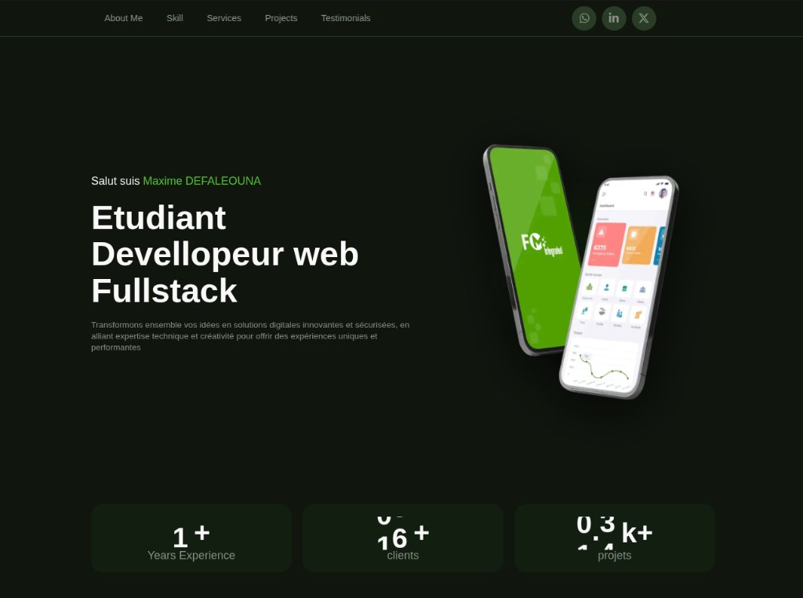

# Maxime DEFALEOUNA - Portfolio Developpeur Web Fullstack

Portfolio personnel moderne et interactif concu pour presenter mon profil, mes competences techniques, mes realisations et mes services en tant que developpeur web fullstack.

- **Demonstration en ligne** : [https://maximedefa.netlify.app](https://maximedefa.netlify.app)
- **Auteur** : Maxime DEFALEOUNA

---

## Apercu de la Plateforme

Interface d'accueil epuree en theme sombre avec accents verts, mise en avant du profil et presentation des expertises techniques.



---

## Fonctionnalites Principales

- **Animations au defilement (Scroll animations)** : Integration de la bibliotheque AOS pour dynamiser l'apparition des elements au fur et a mesure de la navigation.
- **Compteurs de statistiques animes** : Visualisation dynamique des annees d'experience, du nombre de clients et de projets realises grace a Odometer.
- **Vitrine de projets interactive** : Carrousels fluides et responsives pour explorer les projets web, mobiles et d'integration avec React Slick.
- **Section Competences (Skills)** : Grille detaillee des technologies maitrisees (frontend, backend, bases de donnees, outils DevOps).
- **Temoignages et Retours d'experience** : Retours clients sous forme de slider interactif.
- **Navigation one-page fluide** : Deplacement direct et anime vers chaque section grace a `react-scroll`.
- **Prise de contact directe** : Formulaire fonctionnel pour les demandes de projets et opportunites professionnelles.
- **Adaptation responsive complete** : Experience optimisee sur smartphones, tablettes et ecrans haute definition.

---

## Technologies Utilisees

| Categorie | Technologies |
| :--- | :--- |
| **Framework & Outils** | React 18, Vite |
| **Animations & Effets** | AOS (Animate On Scroll), React Odometer |
| **Sliders & Navigation** | React Slick, Slick Carousel, React Scroll |
| **Icones & Styles** | React Icons, CSS3 moderne (Variables de theme) |
| **Hebergement & CI/CD** | Netlify |

---

## Installation et Execution en Local

### 1. Prerequis
- Node.js (version 18 ou superieure)
- npm ou yarn

### 2. Cloner le depot
```bash
git clone https://github.com/maximedefaleouna/portfolio.git
cd portfolio
```

### 3. Installer les dependances
```bash
npm install
```

### 4. Demarrer le serveur de developpement
```bash
npm run dev
```

### 5. Generer la version de production
```bash
npm run build
```

---

## Auteur

**Maxime DEFALEOUNA**
- Portfolio : [https://maximedefa.netlify.app](https://maximedefa.netlify.app)
- GitHub : [@maximedefaleouna](https://github.com/maximedefaleouna)
